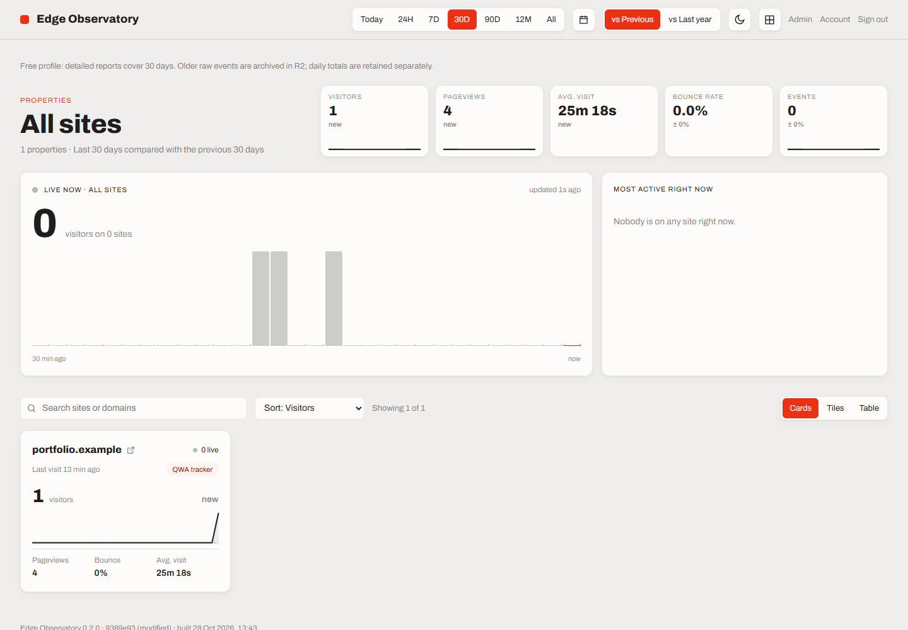

# Edge Observatory

Website analytics built with Cloudflare Workers, Durable Objects and React. It tracks pageviews, sessions, traffic sources and Web Vitals without cookies or storing raw IP addresses.



Each site has a Durable Object that stores recent events in SQLite and writes Parquet archives to R2. The dashboard queries SQLite directly; D1 stores site settings, users and daily totals. An optional DuckDB Worker can query the archives.

The ingestion path handles tracker retries: an event ID and its event are saved in the same transaction. Failed writes return 503 so the tracker can retry. Archive failures leave events queued locally.

## Run locally

Requires Node.js 22 or newer.

```sh
npm ci
npm run build
npm run db:local
npm run seed:local
npm run dev
```

Open [localhost:8787](http://localhost:8787). The seed creates a sample site, `portfolio.example`. Storage runs locally and the development config signs you in automatically. No Cloudflare account is needed.

To check the running server from another terminal:

```sh
npm run smoke
```

This sends 20 copies of one event and checks that the report contains one pageview.

## Project layout

```text
apps/
  worker/          HTTP API, ingestion, Durable Objects and D1 migrations
  web/             React dashboard
  query/           SQL compiler and optional DuckDB archive Worker
packages/
  shared/          Event tables and query types
  tracker/         Browser tracker
  tracker-compat/  Plausible-compatible scripts
scripts/           Builds, local fixtures and smoke checks
tools/             Plausible data import
docs/              Architecture, deployment and testing
```

## Tests

```sh
npm run verify
```

Runs type checks, unit tests, Durable Object integration tests, the dashboard build and a Worker bundle check. See [testing](docs/testing.md) for individual commands and failure cases.

## Storage limits

The SQLite profile keeps 30 days of event detail and defaults to 1,000 accepted events per site per day. Daily totals are stored separately. Older Parquet archives need the optional query Worker for detailed reports.

Duplicate receipts expire after 72 hours, but matching also depends on daily visitor identities. A changed identity or a retry after later salt rotations can count again. Expired data is cleaned up during archive flushes.

The project currently runs locally. The event cap is not a billing cap; hosted R2 usage can incur charges. See [deployment](docs/DEPLOY.md) for the single-Worker configuration and [architecture](docs/architecture.md) for storage and query details.

Based on [Quick Web Analytics](https://github.com/Zesty0wl/quick-web-analytics), under the [MIT licence](LICENSE). Dependency licences are listed in [third-party notices](THIRD_PARTY_NOTICES.md).
