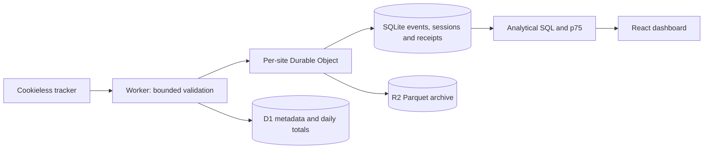

# Edge Observatory

Website analytics on Cloudflare Workers, with transactional event receipts, native SQLite reporting and R2 Parquet archives.

Tracker retries should not inflate reports, failed writes should not receive successful persistence acknowledgements, and archive outages should not discard pending events. Executable tests cover these guarantees.




## Local development

Requires Node 22+ and npm. No cloud account or paid plan is needed locally.

```sh
npm ci
npm run verify
npm run db:local
npm run seed:local
npm run dev
```

Open http://localhost:8787. Run `npm run smoke` in another terminal. `portfolio.example` is a synthetic fixture. The development administrator bypass works only on loopback hostnames; never deploy the local config.

## Implemented behavior

- Rotating visitor identities without storing raw IP addresses.
- Validated event IDs, duplicate suppression and transactional session/event/receipt writes.
- Bounded 16 KiB bodies and retryable 503 responses when persistence fails.
- Native SQLite traffic, engagement, dimension and timezone reports; interpolated p75 Web Vitals.
- Thirty days of detailed queries, separate D1 daily totals and Parquet archives.
- Authenticated APIs, React dashboard, live updates and backpressure-driven query streams.

The default free profile uses Durable Object SQLite without a paid DuckDB Worker. An optional archive query engine remains in source for local experimentation.

## Verification

`npm run verify` runs application/integration typechecks, workspace tests, Workers-runtime tests, frontend production build and free-profile Worker dry-run. `npm audit` checks dependencies.

The HTTP smoke sends twenty copies of one event and verifies one logical pageview through the running native backend. Tests cover eviction, salt rotation, rollback, R2 failure, concurrent ingest/flush recovery, SQL filters, percentile ranking, midnight-crossing reports and incomplete historical rollups. [Verification report](VERIFICATION_REPORT.md).

## Deployment

**Delivered status: local only, as requested. No live deployment is claimed.**

`wrangler.free.example.jsonc` defines one Worker, SQLite Durable Objects, D1 and R2, without development bypasses, demo flags or a paid query binding.

When remote resources are authorized: create D1 `edge-observatory` and R2 `edge-observatory-data`; copy the free example to gitignored `wrangler.jsonc`; set its database ID and actual hostname; apply migrations with `npx wrangler d1 migrations apply edge-observatory --remote -c wrangler.jsonc`; configure Cloudflare Access and `ACCESS_TEAM_DOMAIN`, `ACCESS_AUD`, `BOOTSTRAP_ADMINS` secrets; build and deploy using `npx wrangler deploy -c wrangler.jsonc`. Protect dashboard paths while leaving tracker/ingestion public. The application also validates Access JWTs.

## Limits and tradeoffs

The free profile caps accepted events at 1000/site/day and detailed SQLite history at 30 days. Older raw events are archived; free-profile drilldowns do not query historical Parquet. Daily totals persist separately. Partial coverage is explicit, and unavailable history cannot become authoritative zero rollups.

Receipts last 72 hours, but matching uses current/previous daily visitor identities. Identity changes or later rotations can count a retry again. Physical cleanup occurs on flush. Bots, unknown sites and capped traffic may deliberately be acknowledged without storage.

These limits do not cap every request or guarantee zero billing. R2 has metered overages; this demonstration stays local. No production throughput or uptime is claimed.

[Technical design](docs/design.md) · [MIT license](LICENSE) · [Third-party notices](THIRD_PARTY_NOTICES.md)
