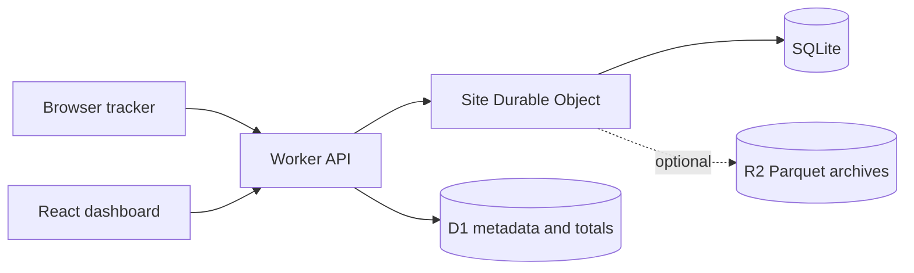

# Architecture

The SQLite deployment profile runs the API and dashboard on one Worker. Each site has a SQLite Durable Object; D1 stores shared metadata and daily totals. R2 archives are optional and are not bound in this profile.

## Transactional ingestion

A per-site Durable Object owns sessionization. One SQLite transaction commits the session, event, optional receipt and durable dirty marker. Storage failure returns 503. Receipts include visitor identity and event ID; checking the previous daily identity handles salt rotation while bounding linkability and deduplication scope.

The browser serializes each event once and makes at most four attempts. Network failures, timeouts, HTTP 408, 429 and 5xx trigger retries after 500 ms, 1 s and 2 s. A server's Retry-After can extend a delay to at most 10 s. Each attempt times out after 5 s. Retries are best effort while the page remains open; there is no persistent browser queue.

SQL cannot interleave inside a synchronous transaction. R2 flushes can interleave with ingestion: each dirty day therefore has a generation, and flush only clears an unchanged generation. Rollback restores the prior transaction generation map without erasing unrelated successful writes. Archive failures retain local data and dirty markers for retry.

## Reporting

The shared query compiler targets DuckDB or native SQLite. The default SQLite profile executes queries inside the Durable Object. Metric families join against the union of their grouping keys, preserving event-only buckets across session boundaries. Validated dimensions and quoted filter values prevent arbitrary SQL exposure.

SQLite aggregates Web Vitals samples; the Durable Object interpolates p75. Percentile groups are sorted and limited after numeric conversion. Time bucketing uses explicit timezone-offset segments. Query streams pull one result at a time.

## Storage and retention

SQLite owns recent detail, sessions and receipts. D1 holds metadata and completed daily totals. Detailed retention is 30 days; SQLite drilldowns do not query older archives. Current and comparison reports display a warning when either period includes unavailable detail. Rollups start at fully retained local days and skip partial results so missing history stays distinguishable from zero traffic. A cutoff exactly at local midnight includes that complete day.

Duplicate receipts expire after 72 hours. Matching uses the current and previous daily visitor identities, so identity changes or later salt rotations can cause a retry to count again. Expired records are removed during maintenance.

With `ARCHIVE_MODE=disabled` and `QUERY_MODE=sqlite`, maintenance clears archive dirty markers without uploading data, purges expired detail and re-arms a daily cleanup alarm while events remain. Expired detail is deleted without an archive copy. This mode is explicit: an unexpectedly missing R2 binding in archive mode fails without clearing pending data.

Production identity uses validated Cloudflare Access JWTs. The deployment example omits local bypass flags and defaults to 100 accepted events per site per day; SQLite mode enforces an upper bound of 1,000. Requests are limited to 16 KiB. Queries and rejected requests still use resources, so the event cap is not an account-wide spending limit. A busy site's ingestion and queries share one Durable Object.
